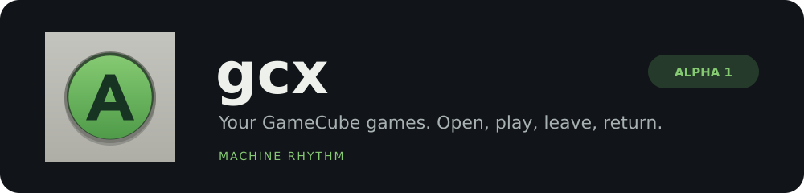

# gcx

**Your GameCube games. Open, play, leave, return.**

A game-first, Rust-first native GameCube player from Machine Rhythm. A separate
sister application to PSX and xbx, starting with stock Android ARM64 foldables.

The intended experience is a small local collection, comfortable GameCube controls,
dependable per-game progress and automatic resume, and optional Home Screen icons
that open individual games directly. No core-selection catalog, accounts, game
uploads or mandatory network connection.

## What exists today

**GCX-1 implementation in progress.** A Rust host now builds against pinned Dolphin
and passes an original GameCube CPU fixture, native input readback, atomic card
commit and teardown checks on Linux. The Android Rust player and narrow native
adapter link on ARM64. A private development APK passes ABI, alignment, signature
and resource checks. Wind Waker renders its title, intro and file-selection menu
on a secondary stock Android device, with Start, Control Stick and A input and
owner-confirmed audible sound. The owner has played into Wind Waker’s interactive world and saved through the
game. Normal gcx Stop, exclusion through native teardown, and a cold-process
game-menu reload preserved the one-rupee marker. Actual cards are privately backed
up. The landscape update now runs on Pixel 4 with GameCube colors and labels;
the owner reports it works. Pause/Resume, one Home/return and clean Stop passed.
The owner accepted the edge-to-edge picture correction, and a fresh-process reload
of the earlier card save passed on that build. A misplaced system Home handle
after bar reveal remains open. The full control matrix and extended surface
transitions remain unqualified; the first Fold world result is detailed below. Rust-owned coherent
machine/card checkpoints passed actual native restore/failure fixtures and an
ABI7 Pixel4 fresh-process return to unsaved scenes, with owner-confirmed sound,
controls and retained pause intent. The newer ABI8 input/UI build rendered its
controls and restored an unsaved Wind Waker scene in a genuinely new process on
Pixel4, with intentional pause retained until Resume. The owner confirmed sound,
movement/action, C Stick and control feel after restore. Its validated checkpoint
generation and ordinary saves are privately backed up. Actual library switching
Wind Waker → Twilight Princess → Wind Waker returned the unsaved scene with
owner-confirmed sound, controls and no audio bleed. Twilight Princess also returned
to its saved opening dialogue in a later process, with owner-confirmed sound and
A input; its interactive world remains untested. Actual Add to Home testing found
the current launcher reports pinning unsupported, so OS pins and physical taps
remain blocked. Direct Home departure while playing also returned automatically
to the unsaved scene in a new process, with owner-confirmed sound and action input.
A later Pause/freeze report during cleanup remains unresolved; recovery preserved
the latest complete checkpoint and ordinary saves before controlled process retirement.
No clean Stop is claimed for that window. Broad lifecycle and full controls remain
unqualified. Rust GameId links and pin-request code are implemented. See
[native reproduction and limits](native/README.md).

The first alpha presentation adds the sibling green-A identity, a cleaner native
library and pause flow, and Rust-owned touch-layout editing with a separate input
test. Opacity, dead zone, following sticks and haptics are configurable; positions
are saved separately for each screen. The Alpha 1 APK is built, privately preserved and installed on the Fold and Pixel 4. The Fold library and control editor rendered
on the inner display; Pixel 4 rendered Wind Waker intro/title graphics and passed
a bounded Pause/Resume UI check. The fixed-footer update keeps Resume and Stop visible and passed an automated
Pause/Resume/normal joined Stop check on Pixel 4, with coherent backup and verified
return. The same build now renders Wind Waker's world on Fold, with owner-confirmed
movement/action/C Stick. Intermittent sound/frame lag, narrow picture, crowded
controls and inconsistent haptics are reported. Home-return produced two gcx-named
processes then process loss; no Fold Resume/normal Stop or latest-generation backup
result is claimed. The Fold was verified returned. The Rust deck/visual/haptic
refinement and a bounded presentation-diagnostic repair are now installed on
Pixel 4. Its same-process Home return, fresh graphics, Pause/Resume and normal
joined Stop passed, with independently backed-up saves/checkpoint and verified
device return. Android accepted a haptic request; physical feedback quality and
the new layout on Fold remain unqualified. Fold exit diagnostics and current-data
backup await a fresh offered window. Fold ordinary-save/reload, resume, posture
and performance qualification remain due.

A focused native regression exposed our input hook consuming queued presses on
GameCube connection/status probes before a button packet. Sampling now occurs at
the actual SI data read; the same Start/A cases fail before and pass after the
repair. The new ARM64 build is installed on Pixel 4 with existing data and both
recovery candidates preserved. Its zero-duration menu contact still left Wind
Waker at the title; that case remains unresolved. Separately title-proven ordinary
menu contacts loaded the existing quest into the bridge world. Pause/Resume and
one same-process Home/return/Pause/Resume worked. Final detailed acknowledgments
exhausted their diagnostic budget, so initial automatic cleanup remained pending.
A bounded cleanup-only follow-up protected the current generation and ordinary
saves, obtained an explicit joined/durable/released Stop completion, and verified
device return. The Rust diagnostic-reserve correction is now installed on Pixel4:
actual-world Pause/Resume, same-process Home/return and final paused/checkpoint
acknowledgments passed, followed by automatic same-lease backup, fully traced
joined Stop and verified return. No latency or original-freeze fix is claimed.

The unchanged f9de0b0 / b4c92127 candidate now passes an automated ordinary-save
check on Pixel4: actual movement/action/C Stick, newly acquired Hero’s Clothes,
in-game Save, normal joined Stop and a fresh-process game-menu reload retaining
the green outfit and 23 rupees. Final protected joined Stop and device return passed.
Both ordinary profiles and retained backups remain protected. The owner was away;
this adds no human audio/control-feel, latency or endurance result. The original
later-play freeze remains open. See [acceptance](docs/ACCEPTANCE.md).

GameCube is the initial scope. Dolphin's Wii capability is not a promise of Wii
support in gcx. A Wii expansion, iOS implementation and multiple resident games
are separate decisions. Google Play and ordinary Apple App Store distribution
remain intended goals, not approvals or guaranteed performance.

## Begin

Read [AGENTS.md](AGENTS.md) and the [current state](docs/state.toml), then use the
[verified GitHub receipt](docs/github-state.toml) to locate actual live issues.
On a locally bootstrapped checkout, run `bash scripts/start-codex.sh` to begin the
included implementation assignment with your normal Codex permissions.

| Document | Purpose |
| --- | --- |
| [Product](docs/PRODUCT.md) | The game-first experience and boundaries |
| [Architecture](docs/ARCHITECTURE.md) | Native ownership, per-game sessions, cards and checkpoints |
| [GameCube feasibility](docs/GAMECUBE_FEASIBILITY.md) | Dolphin, boot, input, formats and mobile risks |
| [Acceptance](docs/ACCEPTANCE.md) | Separate build, game, save and lifecycle evidence |
| [Distribution](docs/DISTRIBUTION.md) | GPL lineage, bundled resources and store requirements |
| [Operations](docs/OPERATIONS.md) | Shared workstation, source and device safety |
| [PSX transfer](docs/PSX_TRANSFER.md) | Selective reuse without a product merger |
| [Sources](docs/SOURCES.md) | Observed primary sources and precise limits |
| [Master seed](handoff/MASTER_SEED.md) | Complete standalone fresh-chat handoff |
| [Local setup](handoff/LOCAL_SETUP.md) | Publish the foundation and start Codex |

## Engineering and source

New substantive first-party application, host, runtime, input, UI and persistence
logic is Rust. Borrowed C/C++ may be retained, repaired and replaced where justified.
A vendor directory or existing API is not an instruction to accumulate wrappers.
We borrowed an engine to avoid rebuilding a whole console, not to abandon control.

Original seed work uses [MIT](LICENSE). Incorporated code keeps its actual license;
Dolphin declares GPL-2.0-or-later. Our MIT license and a C ABI do not remove the
combined distribution's obligations. See [THIRD_PARTY.md](THIRD_PARTY.md).

No proprietary games, Nintendo firmware, private saves, keys or copied brand
artwork are supplied. gcx is an independent project, not affiliated with Nintendo
or the Dolphin project. The name is a project choice, not a trademark clearance.
